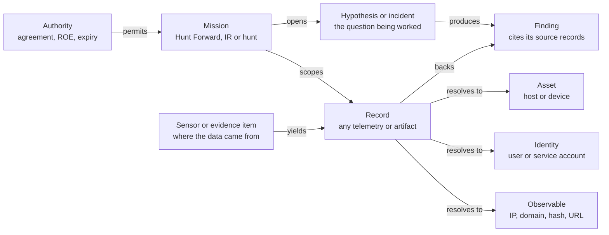

# Cyber Defense Database: Universal Collection Data Plan

As of November 11, 2026

## Purpose, scope and assumptions

This plan gives every collection in the database one shared record envelope and sorts the collections into four families, so data gathered on a Hunt Forward mission, an incident response or a threat hunt lands in the same shape and can be queried together.

The four families are telemetry (continuous event streams), forensic and triage artifacts (point-in-time pulls), context and reference data, and mission and case records.

Assumptions taken, since the request left them open:

- "Collections" is read both ways: the datasets stored in the database, and the data teams go out and gather. The plan covers both.
- The design is storage-neutral. A collection can be a table, an index or a document collection.
- Use is defensive only, on networks you own or are invited onto under written authority.
- The design is unclassified. Marking fields let it carry whatever handling regime you operate under.
- Tiers and retention periods are starting values to tune against your storage budget and legal terms.

## Mission drivers

All three mission types need the same host, network and identity telemetry; they differ in the case wrapper around it and in how the data must be handled.

| Mission | How it works | What it demands of the data |
| --- | --- | --- |
| Hunt Forward | A team deploys, by invitation, to a partner's network to observe and detect malicious activity. It does not remediate; the partner acts on the findings, and the insights come home to harden other networks ([Cyber 101: Hunt Forward Operations](https://www.960cyber.afrc.af.mil/News/Article-Display/Article/3219164/cyber-101-hunt-forward-operations), [USCYBERCOM on Albania](https://www.cybercom.mil/Media/News/Article/3337717/)). | Per-partner segregation and releasability on every record. Provenance for deployed sensors. Fast baselining of an unfamiliar network. Exportable indicators, TTPs and malware samples. Recommendations tracked as handed to the partner, not as actions taken. |
| Incident response | A known or suspected compromise is scoped, contained, eradicated and recovered from. | Timeline reconstruction across hosts. Point-in-time forensic artifacts. Evidence integrity and chain of custody. Long lookback, because dwell time often predates detection. Response actions with owner and time. |
| Threat hunt | Analysts test hypotheses about adversary behavior with no alert as the trigger. | Broad, searchable telemetry with enough history. Baselines to judge what is unusual. Every hypothesis, query and outcome recorded, including negative results. A path from finding to detection rule. |

The artifact lists in later sections follow the joint Five Eyes advisory [Technical Approaches to Uncovering and Remediating Malicious Activity](https://www.cyber.gc.ca/en/news-events/joint-cybersecurity-advisory), which doubles as an investigation playbook.

## Universal record envelope

Every record in every collection carries these fields, so any two collections can be joined on time, scope, entity and handling without knowing their payloads.

| Group | Field | Type | Purpose |
| --- | --- | --- | --- |
| Identity | `record_id` | UUIDv7 | Unique, time-sortable key |
| Identity | `collection` | string | Name of the collection the record belongs to |
| Identity | `schema_version` | string | Version of the collection schema used to write it |
| Time | `event_time` | timestamp, UTC | When the activity happened on the source |
| Time | `observed_time` | timestamp, UTC | When the sensor or collector saw it |
| Time | `ingest_time` | timestamp, UTC | When the database stored it |
| Time | `time_source` | enum | Source clock, original zone and known offset |
| Scope | `org_id` | key | Data owner: your organization or the partner |
| Scope | `network_id` | key | Enclave or network segment the data came from |
| Scope | `mission_id` | key, nullable | Mission that gathered it; null for standing telemetry |
| Scope | `case_id` | key array | Cases or hunts the record is attached to |
| Provenance | `sensor_id` | key | Sensor, agent or collector instance |
| Provenance | `collector` | object | Tool name, version and configuration hash |
| Provenance | `collection_method` | enum | Streamed, triage pull, image, manual upload, partner-provided |
| Provenance | `evidence_id` | key, nullable | Evidence item the record was parsed from |
| Provenance | `raw` | bytes or pointer | Original record, kept unmodified |
| Provenance | `raw_sha256` | hash | Integrity check on the original |
| Provenance | `parser` | object | Parser name and version, plus parse warnings |
| Entities | `asset_id` | key, nullable | Resolved host or device |
| Entities | `identity_id` | key, nullable | Resolved user or service account |
| Entities | `observables` | array | Every IP, domain, hash, URL and account name in the record, typed |
| Handling | `classification` | enum | Classification or sensitivity label |
| Handling | `tlp` | enum | TLP 2.0 marking |
| Handling | `releasability` | array | Who the record may be shared with |
| Handling | `authority_id` | key | Authority or agreement under which it was collected |
| Handling | `pii` | flags | Presence and kind of personal data |
| Lifecycle | `retention_class` | enum | Drives hot, cold and purge timing |
| Lifecycle | `expires_at` | timestamp | Computed purge date |
| Lifecycle | `legal_hold` | boolean | Blocks purge while true |
| Enrichment | `attack` | array | ATT&CK tactic and technique IDs, with framework version |
| Enrichment | `tags` | array | Analyst and pipeline labels |
| Enrichment | `severity`, `confidence` | enum | Set by detections or analysts, never by the source alone |

Three rules keep the envelope trustworthy: never overwrite `raw`, never change `event_time` after ingest, and write enrichment as additions with their own author and time.

## Telemetry collections

Telemetry is 30 continuous event collections across seven domains; the fields listed are in addition to the envelope.

### Host

| Collection | Typical sources | Key fields |
| --- | --- | --- |
| `process_events` | EDR, Sysmon, Windows 4688, auditd, eBPF | Process GUID, PID, parent GUID, image path, command line, hashes, signer, user, integrity level, session |
| `file_events` | EDR, Sysmon, auditd | Path, action, hashes, size, actor process, origin URL or zone marker |
| `registry_events` | EDR, Sysmon | Key, value, data, action, actor process |
| `module_load_events` | EDR, Sysmon | Module or driver path, hashes, signer, loading process |
| `script_events` | PowerShell script block and module logs, AMSI, shell history | Script text or block, decoded content, interpreter, host process |
| `host_network_events` | EDR, Sysmon, host firewall | Process GUID, 5-tuple, direction, DNS name requested |
| `os_auth_events` | Windows Security log, sshd, PAM, sudo | Logon type, source host and IP, target account, authentication package, result, logon ID |
| `persistence_events` | Service, scheduled task, WMI subscription, cron and systemd changes | Mechanism, name, command, actor, before and after values |
| `endpoint_alerts` | EDR and antivirus detections | Rule or signature, action taken, file or process reference, vendor severity |
| `device_events` | Removable media, storage volume and peripheral logs | Device ID, serial, mount point, user |

### Network

| Collection | Typical sources | Key fields |
| --- | --- | --- |
| `flow` | NetFlow, IPFIX, Zeek conn, cloud flow logs | 5-tuple, bytes and packets each way, duration, TCP state, community ID, sensor vantage |
| `dns` | Resolver logs, Zeek, passive DNS sensor | Query, type, response code, answers, TTL, client, resolver |
| `http` | Forward proxy, Zeek, web gateway | Method, host, URI, user agent, referrer, status, bytes, proxy action, MIME type |
| `tls` | Zeek, proxy, load balancer | SNI, version, cipher, JA3 or JA4 fingerprints, certificate chain hashes, issuer, subject, validity |
| `firewall` | Firewall and NAT logs | Rule, action, 5-tuple, translated addresses, zones |
| `ids_alerts` | Suricata, Snort, NDR | Signature ID, category, 5-tuple, payload excerpt, flow reference |
| `remote_access` | VPN, RDP gateway, SSH bastion, ZTNA | User, source IP, assigned IP, device posture, session start and end, bytes |
| `dhcp` | DHCP servers | MAC, IP, hostname, lease start and end |
| `pcap_index` | Full or triggered packet capture | Capture file pointer, time range, link, filter, hash; packets stay in object storage |

### Identity

| Collection | Typical sources | Key fields |
| --- | --- | --- |
| `directory_auth` | Domain controllers: Kerberos and NTLM events | Account, service name, ticket options, encryption type, client address, result code |
| `idp_signins` | Entra ID, Okta and other identity providers | User, application, IP, device, MFA method and result, risk signals, conditional access outcome |
| `directory_changes` | Directory service change logs | Object, attribute, old and new value, actor; covers group membership, GPO, trusts and delegation |
| `privileged_sessions` | PAM, jump hosts | Account checked out, requester, target, session recording pointer |

### Cloud and SaaS

| Collection | Typical sources | Key fields |
| --- | --- | --- |
| `cloud_control_plane` | CloudTrail, Azure Activity, GCP audit logs | Principal, API call, resource, parameters, source IP, result, session and role chain |
| `saas_audit` | Microsoft 365 unified audit, Google Workspace, other SaaS | Actor, operation, object, client application, OAuth grant details |
| `cloud_data_access` | Object storage and key vault data-plane logs | Principal, object, operation, bytes |
| `container_audit` | Kubernetes audit, container runtime | Verb, resource, namespace, service account, image, exec commands |

### Email, application and OT

| Collection | Typical sources | Key fields |
| --- | --- | --- |
| `email_events` | Mail gateway, message trace, URL click logs | Envelope and header senders, recipients, subject, message ID, attachment hashes, URLs, verdict, authentication results |
| `application_logs` | Web servers, databases, hypervisors, network device syslog and AAA, PKI | Application, action, actor, object, result; device configuration changes kept in full |
| `ot_events` | ICS protocol monitors, engineering workstations, controllers, historians | Protocol and function code, controller, mode, logic or firmware change, operator, setpoint writes |

Keep message bodies, packet payloads and script content out of general query scope by default; see Handling.

## Forensic and triage collections

These 12 collections hold point-in-time pulls from specific systems; each record links to an evidence item, and large binaries stay in object storage with only metadata and parsed output in the database.

| Collection | What it holds | Collected when |
| --- | --- | --- |
| `triage_packages` | Manifest of a triage pull: host, tool, targets collected, file list with hashes, errors | Every host touched in IR; sampled hosts on a hunt |
| `system_state` | Running processes and services, process trees, listening ports, live connections, local users, installed software, routes, DNS settings, hosts file | Start of any host examination, before changes are made |
| `persistence_snapshot` | Run keys and autoruns, services, scheduled tasks, WMI subscriptions, GPO scripts, cron, systemd units, `authorized_keys`, kernel modules | Same pull as system state; again after eradication to confirm |
| `execution_artifacts` | Prefetch, Shimcache, Amcache, SRUM, UserAssist, BAM, shell history | IR scoping; hunts for historic execution |
| `filesystem_timeline` | MFT, USN journal, inode timelines, Volume Shadow Copy listings | Hosts confirmed or strongly suspected compromised |
| `user_artifacts` | Browser history and downloads, LNK files, jump lists, shellbags, recent documents | Initial access and user-activity questions |
| `log_archives` | Exported EVTX, `/var/log`, journald, application log bundles | Whenever local logs were not already forwarded |
| `memory_images` | Image metadata plus parsed output: process list, injected regions, handles, network artifacts, loaded modules | Suspected fileless or in-memory activity, before reboot or isolation |
| `disk_images` | Image metadata, acquisition method, hashes, partition layout | Key systems where full reconstruction or legal action is likely |
| `malware_samples` | Sample metadata, cryptographic and fuzzy hashes, static analysis, sandbox behavior, extracted configuration, YARA matches | Any suspicious binary or script recovered |
| `network_device_snapshots` | Running and startup configuration, firmware hash, routing, ARP and CAM tables, local accounts | Edge devices in scope; any device suspected of tampering |
| `cloud_snapshots` | IAM policy export, OAuth application grants, mailbox rules, access keys, federation settings | Identity or cloud involvement in the case |

The host items mirror the artifact list in the [joint advisory](https://www.cyber.gc.ca/en/news-events/joint-cybersecurity-advisory), which also warns responders to collect before they remediate.

## Context and reference collections

These nine collections describe the environment and the threat, and they are what turns an event into a judgment about whether it is normal.

| Collection | What it holds | Notes |
| --- | --- | --- |
| `assets` | Hosts and devices: names, addresses over time, OS, role, owner, criticality, location, sensor coverage | Addresses are time-bounded so an IP resolves to the right host on the right day |
| `identities` | User, service and machine accounts: identifiers, groups, privileges, owner, status, last credential change | Flag privileged and service accounts explicitly |
| `network_map` | Subnets, VLANs, enclaves, trust boundaries, egress points, sensor placement | Built in the first days of a Hunt Forward mission |
| `software_inventory` | Installed software and versions per asset, with first and last seen | Feeds both vulnerability matching and rarity analysis |
| `vulnerabilities` | Scan findings per asset: CVE, severity, exploited-in-the-wild flag, first seen, fixed date | |
| `config_baselines` | Expected configuration per asset class: services, ports, autoruns, golden image hashes | Diffed against `system_state` and `persistence_snapshot` |
| `behavior_baselines` | Computed norms: process and parent-child rarity, logon hours, usual peers, DNS and destination prevalence | Stored per network, with the window they were computed over |
| `threat_intel` | Indicators, actors, malware families, campaigns and TTPs, with source, confidence, validity window and marking | Keep the source's original object alongside the normalized one |
| `detections` | Rule content (Sigma, YARA, Suricata, queries), version, ATT&CK mapping, test status, false-positive notes | Each rule links back to the finding or hypothesis that produced it |

## Mission and case collections

These 14 collections record why data was gathered, under what authority, what analysts did with it and what came out; one `missions` record with a type field covers Hunt Forward, incident response and threat hunt alike.

| Collection | What it holds | Used by |
| --- | --- | --- |
| `missions` | Type, objectives, partner or owner, team, dates, status, parent mission | All |
| `authorities` | Legal authority, partner agreement or engagement letter, rules of engagement, permitted actions, data-handling and retention terms, expiry | All; mandatory before any collection on a Hunt Forward mission |
| `scope_items` | Networks, assets and accounts in and out of scope, with who approved each | All |
| `collection_requirements` | The question to answer, the data that answers it, the source and sensor, status and gaps | All |
| `sensors` | Each deployed sensor or agent: placement, tap or span details, version, online periods, clock offset, health | All; critical for deployed kits |
| `hypotheses` | Statement, ATT&CK techniques, data needed, outcome (confirmed, refuted, inconclusive), reason | Threat hunt, Hunt Forward |
| `queries_run` | Query text, time range, collections touched, analyst, result count, linked hypothesis or case | All |
| `findings` | Observation, supporting record IDs, affected entities, ATT&CK mapping, confidence, severity, status | All |
| `incidents` | Category, severity, detection source, phase timestamps (detected, contained, eradicated, recovered), root cause, impact | Incident response |
| `timeline_events` | Analyst-curated attack timeline entries, each citing source records | Incident response, Hunt Forward |
| `evidence_items` | Item description, source system, acquisition method and time, hashes, storage location | All |
| `custody_log` | Append-only: evidence item, action, person, time, hash verified | All |
| `response_actions` | Action, target, owner, requested and completed times, result. On Hunt Forward missions the action type is "recommended to partner" | Incident response, Hunt Forward |
| `products` | Reports, indicator packages and briefings: version, marking, recipients, release approval, source findings | All |

Record negative results with the same care as positive ones. A refuted hypothesis with its queries attached tells the next team what has already been ruled out and over which time range.

## Entity model

Every record sits at the center of nine linked entities: it is permitted by an authority, scoped by a mission, traceable to a sensor or evidence item, and resolved to the assets, identities and observables it names.

A finding is only as strong as this chain: from the finding you can walk back to the records, the sensor that produced them and the authority that allowed the collection.

The joins depend on stable keys, because natural identifiers drift.

| Entity | Key | Natural identifiers kept as attributes | Why the key matters |
| --- | --- | --- | --- |
| Asset | `asset_id` | FQDN, MAC, serial, agent ID, cloud instance ID, IPs with validity windows | An IP maps to different hosts on different days; resolve by time using `dhcp` and `assets` |
| Identity | `identity_id` | SID, object GUID, UPN, cloud principal ID | One person holds several accounts; link them through an owner field |
| Process | Process GUID: asset, PID and start time | Image path, hashes | PIDs are reused |
| Network session | Community ID | 5-tuple and start time | Joins `flow`, `dns`, `tls`, `http`, `ids_alerts` and `host_network_events` |
| File | SHA-256 | Path, name, MD5, SHA-1 | Names and paths change; content does not |
| Observable | Type plus normalized value | Value as seen | Lets one lookup hit every collection and `threat_intel` |
| Mission, case, evidence | `mission_id`, `case_id`, `evidence_id` | Human-readable names | Names get reused across years |

## Normalization standards

Adopt one open event schema and four content standards, and apply them at ingest so analysts never translate between vendors at query time.

| Area | Standard | Rule |
| --- | --- | --- |
| Event schema | OCSF or Elastic Common Schema; pick one | Map every telemetry collection to it; keep unmapped vendor fields under a `vendor` object |
| Adversary behavior | MITRE ATT&CK (Enterprise and ICS) | Store technique and sub-technique IDs with the framework version |
| Threat intelligence | STIX 2.1 | Import and export in STIX; keep the original object |
| Sharing marking | TLP 2.0 | Required on every record and product |
| Detection content | Sigma, YARA, Suricata | Store the rule source, not only its compiled form |
| Vulnerabilities and software | CVE and CPE | |
| Timestamps | RFC 3339, UTC | Keep source precision and the original string in `raw` |
| Hashes | SHA-256 primary | Also keep MD5 and SHA-1 for lookups against older intelligence |
| Addresses and names | Native IP type; lowercase FQDN; punycode for internationalized domains | Store both the name as seen and the normalized form |
| Accounts | SID or object GUID as key; UPN and display name as attributes | Never key on a display name |

## Collection priority and retention

Collect Tier 1 everywhere before adding Tier 2 anywhere, and hold security logs for at least 12 months.

| Tier | Collections | Searchable | Total retention |
| --- | --- | --- | --- |
| 1: always on | `process_events`, `script_events`, `os_auth_events`, `directory_auth`, `idp_signins`, `directory_changes`, `dns`, `flow`, `http`, `remote_access`, `endpoint_alerts`, `ids_alerts`, `cloud_control_plane` | 90 days | 12 months or more |
| 2: add as coverage matures | Remaining host events, `tls`, `firewall`, `dhcp`, `email_events`, `saas_audit`, `cloud_data_access`, `container_audit`, `privileged_sessions`, `application_logs`, `ot_events` | 30 days | 12 months |
| 3: targeted | `pcap_index` and packet files, `memory_images`, `disk_images` | Packets: rolling 24 to 72 hours | Packets tagged to a case, and all images: life of the case |
| Forensic and triage | All other artifact collections | Life of the case | Case closure plus your policy period |
| Context and reference | All | Current state plus full history | Indefinite; history is small and high value |
| Mission and case | All | Indefinite | Per records policy; `custody_log` is never purged before its evidence |
| Partner-owned data | Anything with a partner `org_id` | Mission duration | Whatever the agreement in `authorities` states; default to purge or return at mission close |

The searchable windows are starting values. The floors come from the [joint advisory](https://www.cyber.gc.ca/en/news-events/joint-cybersecurity-advisory): log data for at least one year, NetFlow for at least 180 days and packet capture for at least 24 hours.

Size the searchable tier to the hunt, not the archive. CISA's 2026 logging guide makes the same point: retention does little if the right data cannot be searched within the window an investigation needs ([Federal News Network](https://federalnewsnetwork.com/cybersecurity/2026/08/cisa-wants-agencies-to-maximize-insight-from-cyber-data-logging/)).

## Handling, sharing and provenance

Access, sharing and purge decisions are all computed from the envelope's handling fields, so a record with any of them missing is rejected at ingest.

- **Segregation by owner.** Enforce `org_id` at the storage layer, with separate encryption keys per partner, so one mission's analysts cannot query another partner's data by accident.
- **Authority before collection.** No sensor record or evidence item is accepted without a valid, unexpired `authority_id` whose scope includes the source network.
- **Sharing.** A product can only cite records whose `releasability` covers every recipient. Indicators derived from partner data inherit the partner's marking until the partner releases them.
- **Personal data.** Store content (message bodies, packet payloads, documents, script text) in restricted fields, separate from metadata. Access needs a case reference and is logged.
- **Integrity.** Hash on ingest, store evidence in write-once storage, and keep `custody_log` append-only. Verify hashes on every transfer.
- **Analyst audit.** `queries_run` doubles as the access log: who looked at what, when and for which case.
- **Clock discipline.** Record each sensor's clock offset in `sensors` and correct at query time; do not rewrite `event_time`.
- **Out-of-band operation.** During an incident, keep the database and team communications off the affected network. The [joint advisory](https://www.cyber.gc.ca/en/news-events/joint-cybersecurity-advisory) lists communicating over the compromised network as a common response mistake.
- **Forward early.** Ship logs off the host as they are written, since intruders clear local logs.

## Data quality and coverage metrics

Track eight measures per collection and per network, because a hunt that finds nothing is only meaningful if coverage was known. Targets are starting values.

| Metric | Definition | Starting target |
| --- | --- | --- |
| Asset coverage | In-scope assets reporting to the collection in the last 24 hours, as a share of `assets` | 95% for Tier 1 |
| Ingest latency | `ingest_time` minus `event_time`, 95th percentile | Under 5 minutes for streamed sources |
| Parse failure rate | Records stored with parse warnings or as raw only | Under 1% |
| Key-field completeness | Records with all key fields populated, such as command line on `process_events` | 98% |
| Entity resolution rate | Records where `asset_id` or `identity_id` resolved | 95% |
| Clock skew | Absolute sensor offset from reference time | Under 2 seconds |
| Gap count | Periods where a sensor or source sent nothing when it should have | Zero unexplained |
| Technique visibility | ATT&CK techniques in your threat model with at least one collection able to observe them | Reviewed per mission |

Attach the coverage figures to every hunt and incident report so readers can see what the conclusions rest on.

## Open decisions and next steps

Seven decisions are yours to make before the schema is fixed.

- [ ] Storage engine or engines: one store for everything, or a search store for telemetry plus a relational store for case records
- [ ] Event schema: OCSF or Elastic Common Schema
- [ ] Classification and marking regime the handling fields must carry
- [ ] Default retention and purge terms for partner-owned data
- [ ] Whether OT and ICS networks are in scope for the first release
- [ ] Expected daily volume per Tier 1 collection, to size the searchable tier
- [ ] Who approves schema changes and how versions are rolled out

Suggested build order:

1. Implement the envelope and its ingest validation.
2. Stand up `missions`, `authorities`, `sensors`, `evidence_items` and `custody_log`, so nothing arrives without provenance.
3. Bring in Tier 1 telemetry with `assets` and `identities` for entity resolution.
4. Add the forensic and triage collections with parsers for one triage tool.
5. Add `hypotheses`, `queries_run`, `findings` and `products`, then run one hunt end to end as the acceptance test.
6. Add Tier 2 and Tier 3 by mission need.

## Sources

- [Technical Approaches to Uncovering and Remediating Malicious Activity](https://www.cyber.gc.ca/en/news-events/joint-cybersecurity-advisory), joint advisory, Canadian Centre for Cyber Security with CISA and Five Eyes partners
- [Cyber 101: Hunt Forward Operations](https://www.960cyber.afrc.af.mil/News/Article-Display/Article/3219164/cyber-101-hunt-forward-operations), U.S. Cyber Command Public Affairs
- ["Committed Partners in Cyberspace": US conducts first defensive Hunt Operation in Albania](https://www.cybercom.mil/Media/News/Article/3337717/), Cyber National Mission Force Public Affairs
- [CISA wants agencies to maximize 'insight' from cyber data logging](https://federalnewsnetwork.com/cybersecurity/2026/08/cisa-wants-agencies-to-maximize-insight-from-cyber-data-logging/), Federal News Network, August 2026

Collection names, field lists, tiers and targets are a proposed design drawn from common practice, not from these sources.
